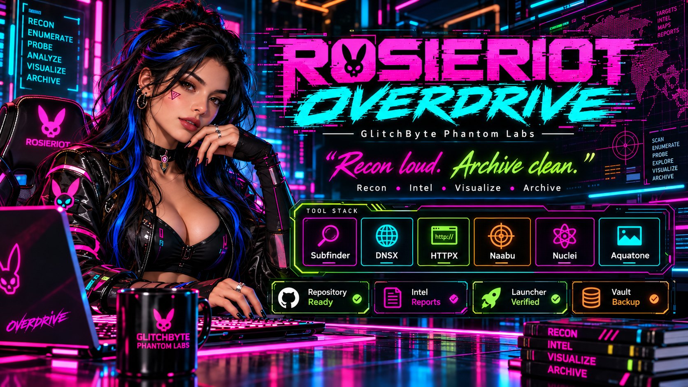

<!-- GLITCHBYTE-UPLOAD-DOOR:START -->
<div align="right"><a href="https://github.com/Hellfire13666/rosieriot-overdrive-2026/upload/main"></a></div>
<!-- GLITCHBYTE-UPLOAD-DOOR:END -->

<div align="center">



# ⚡ ROSIERIOT OVERDRIVE 2026
**GlitchByte Phantom Labs • Ubuntu/Linux • Python 3**

### *“Recon loud. Archive clean.”*

**Recon • Intel • Visualize • Archive**

</div>

**🌈 WORKSHOP PUBLISHING STANDARD:** Every upcoming RosieRiot component or upgrade follows [Build → Run → Publish → Vault](https://github.com/Hellfire13666/glitchbyte-phantom-labs/blob/main/docs/BUILD_PUBLICATION_STANDARD.md): unique source/art, visible honest intel, Firefox only when implemented, tested Simple/Medium/Extra examples, source and setup doors, and verified Backup HQ links. The original release's automatic reports and buffering remain as currently documented until explicitly upgraded.

## 🚀 About
RosieRiot Overdrive is a modular launcher for offline demonstrations and authorized reconnaissance with colorful terminal feedback and organized reports. Its external tools are optional; they are not installed automatically.

| Module | Purpose | Status |
|---|---|---|
| Subfinder | Subdomain discovery | External binary |
| DNSX | DNS resolution | External binary |
| HTTPX (ProjectDiscovery) | Web service probing | External binary |
| Naabu | Port discovery | Opt-in for authorized targets |
| Nuclei | Template-based checks | Opt-in for authorized targets |
| Aquatone | Website screenshots | Optional |

The banner is artwork, not a live status dashboard. Check the actual environment using the verification script.

## 📦 Download
**[Download RosieRiot Overdrive ZIP](rosieriot_overdrive_github_and_vault_bundle/rosieriot_overdrive_2026.zip)** · [View the Python launcher](rosieriot_overdrive_github_and_vault_bundle/rosieriot_overdrive.py) · [View the square artwork](rosieriot_overdrive_github_and_vault_bundle/assets/rosieriot-overdrive-icon.png)

On GitHub, open the ZIP link above and use **Download raw file**, then save it to `~/Downloads/rosieriot_overdrive_2026.zip`.

## 🔧 Findomain companion (optional, external)

Our Ubuntu lab confirmed that a separately installed Findomain successfully printed public-source domain candidates in 23 seconds. The full [Findomain beginner Simple / Medium / Extra guide](https://github.com/Hellfire13666/glitchbyte-phantom-labs/blob/main/docs/tool-showcases/FINDOMAIN_LIVE_CHECK.md) explains `findomain -t example.com`, optional saving, and path troubleshooting. **This is not a claim that Findomain is bundled with or executed by the original RosieRiot engine.**

## 🛠️ Ubuntu install

```bash
mkdir -p "$HOME/PhantomLabsLaunchers"
unzip -n "$HOME/Downloads/rosieriot_overdrive_2026.zip" -d "$HOME/PhantomLabsLaunchers"
bash "$HOME/PhantomLabsLaunchers/rosieriot_overdrive_2026/install_missing_stack.sh"
bash "$HOME/PhantomLabsLaunchers/rosieriot_overdrive_2026/verify_stack.sh"
```

## 🌈 Beginner run recipes | SIMPLE · MEDIUM · EXTRA

**Start here:** [GlitchByte's full beginner runtime cookbook](https://github.com/Hellfire13666/glitchbyte-phantom-labs/blob/main/docs/BEGINNER_RUNTIME_RECIPES.md). These are **actual command examples**, not new `--simple`/`--medium`/`--extra` flags.

### 🌱 SIMPLE | See real public-source hostnames

Requires separately installed Subfinder. Runs passive-source discovery, printing candidate hostnames as results arrive; no report file is requested:

```bash
export PATH="$HOME/go/bin:$PATH"
subfinder -d example.com -silent
```

### ⚡ MEDIUM | Colorful workshop live launcher

This is the newer passive-only launcher **if you already installed it locally** as part of the workshop. The new v3 file is **not bundled with the original published ZIP**. Check for it first:

```bash
LAB="$HOME/PhantomLabsLaunchers/rosieriot_overdrive_2026"
if [ -f "$LAB/run_rosieriot_live.sh" ]; then
    bash "$LAB/run_rosieriot_live.sh" example.com
else
    echo "The separate local v3 launcher is not installed; use SIMPLE or the original engine below."
fi
```

This local upgraded wrapper is designed to print public-source findings, timeouts and a summary without saving unless requested. GitHub visitors must not assume it exists after installing the original ZIP.

### 🔥 EXTRA | The published original engine, authorized scope

The committed Python engine supports bounded `subfinder,dnsx,httpx` operations; DNS and HTTP probes require a target you own or are explicitly authorized to assess:

```bash
LAB="$HOME/PhantomLabsLaunchers/rosieriot_overdrive_2026"
python3 -u "$LAB/rosieriot_overdrive.py" \
  --target YOUR-AUTHORIZED-DOMAIN.example \
  --live --authorized --color always \
  --modules subfinder,dnsx,httpx \
  --max-hosts 20 --timeout 40
```

**Know the original tool's limits:** it captures module output until completion rather than streaming each hostname, and it **automatically saves reports** under `~/RosieRiotReports` by default. The local v3 passive launcher has different behavior; don't confuse them. `naabu`, `nuclei` and `aquatone` are deliberately excluded from these beginner commands.

**Reading results:** A discovered hostname is only a candidate, not proof of a reachable or owned service. Provider timeouts and partial coverage should be reported clearly. Runtime depends on sources and connectivity, not a guaranteed duration. Firefox is not part of the original engine's documented interface.

---

### Offline demo
```bash
python3 "$HOME/PhantomLabsLaunchers/rosieriot_overdrive_2026/rosieriot_overdrive.py" \
  --target example.com --demo --color always
```

### Authorized operations
Check supported options before using live modules:
```bash
python3 "$HOME/PhantomLabsLaunchers/rosieriot_overdrive_2026/rosieriot_overdrive.py" --help
```

Only assess domains or systems you own or are explicitly authorized to test. Live operation has not been independently verified end to end.

## 📂 Tool files and backup index
The upload currently lives inside [`rosieriot_overdrive_github_and_vault_bundle/`](rosieriot_overdrive_github_and_vault_bundle/). Links below point to the **actual uploaded paths**:

- [Installer](rosieriot_overdrive_github_and_vault_bundle/install_missing_stack.sh) · [Verification](rosieriot_overdrive_github_and_vault_bundle/verify_stack.sh)
- [Optional tools instructions](rosieriot_overdrive_github_and_vault_bundle/installers/OPTIONAL_TOOLS.md)
- [Demo output](rosieriot_overdrive_github_and_vault_bundle/examples/demo_output.txt)
- [Patch notes](rosieriot_overdrive_github_and_vault_bundle/patches/PATCH_NOTES.md)
- [Backup checksum manifest](rosieriot_overdrive_github_and_vault_bundle/VAULT_MANIFEST.json)
- [Repository banner](rosieriot_overdrive_github_and_vault_bundle/assets/rosieriot-overdrive-banner.png) · [Square logo](rosieriot_overdrive_github_and_vault_bundle/assets/rosieriot-overdrive-icon.png)

## 🔐 Vault protocol
Every release gets a versioned backup package, an inventory with SHA-256 checksums, and a recovery path. This repository contains a backup manifest; **the separate Vault archive must be uploaded and verified independently**. Do not publish secrets or private target results.

[Phantom Labs HQ](https://github.com/Hellfire13666/glitchbyte-phantom-labs) · [Phantom Backup HQ](https://github.com/Hellfire13666/glitchbyte-phantom-labs-releases)

**Build it. Test it. Archive it. Protect the original.**

<!-- GLITCHBYTE LAB NAV START -->
## 🧭 GLITCHBYTE LAB DOORS

| Destination | Go to page | Upload files |
| --- | --- | --- |
| 👻 **Phantom Labs HQ** | [Main headquarters](https://github.com/Hellfire13666/glitchbyte-phantom-labs) | [📤 HQ upload door](https://github.com/Hellfire13666/glitchbyte-phantom-labs/upload/main) |
| 🌱 **Cultivation Room** | [Building lab](https://github.com/Hellfire13666/glitchbyte-phantom-labs/blob/main/docs/CULTIVATION_ROOM.md) | [📤 Build lab upload door](https://github.com/Hellfire13666/glitchbyte-phantom-labs/upload/main) |
| ⚡ **RosieRiot Overdrive** | [Tool repository](https://github.com/Hellfire13666/rosieriot-overdrive-2026) · [Lab page](https://github.com/Hellfire13666/glitchbyte-phantom-labs/blob/main/docs/ROSIERIOT_OVERDRIVE_LAB.md) | [📤 Overdrive upload door](https://github.com/Hellfire13666/rosieriot-overdrive-2026/upload/main) |
| 🔐 **Phantom Backup HQ** | [Release archive](https://github.com/Hellfire13666/glitchbyte-phantom-labs-releases) · [Tool index](https://github.com/Hellfire13666/glitchbyte-phantom-labs/blob/main/docs/TOOL_VAULT.md) | [📤 Vault upload door](https://github.com/Hellfire13666/glitchbyte-phantom-labs-releases/upload/main) |

> The Cultivation Room currently shares the headquarters repository upload door. Keep dated offline backups; never upload credentials or private reports into public GitHub repositories.

<!-- GLITCHBYTE LAB NAV END -->
